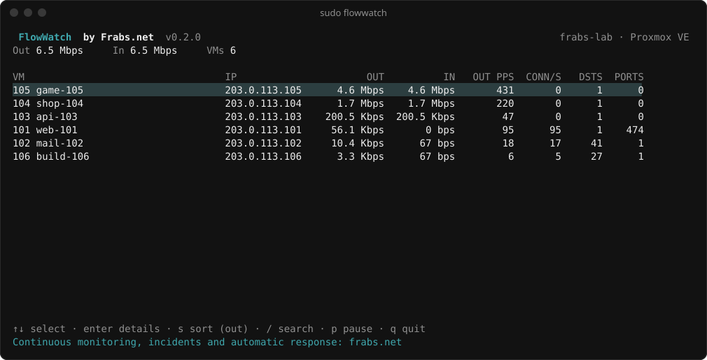
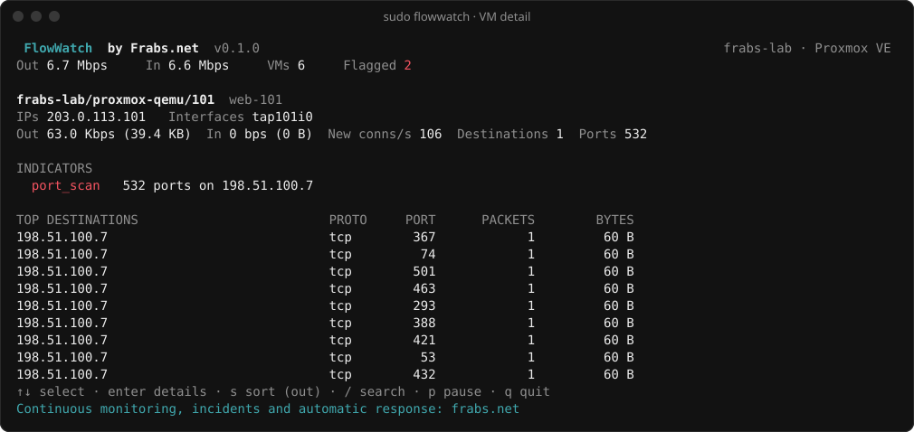

# FlowWatch

**See what traffic every VM on your hypervisor is sending.**
Made by [Frabs.net](https://frabs.net) · Apache-2.0



FlowWatch is a small command-line tool for hosting providers. Run it on a
hypervisor and it shows, per VM, how much traffic is leaving, how many new
connections it is opening, and where that traffic is going.

```
$ sudo flowwatch report
FlowWatch by Frabs.net · hv1 · proxmox (Proxmox VE) · 16:54:37 to 16:54:47

VM                                     PEAK OUT         SENT     RECEIVED  PEAK CONN   DSTS  TOP DESTINATION
105 203.0.113.105                      5.3 Mbps       6.7 MB       6.7 MB          0      1  203.0.113.1 icmp/0
104 203.0.113.104                      1.9 Mbps       2.3 MB       2.3 MB          0      1  203.0.113.1 icmp/0
103 203.0.113.103                    205.5 Kbps     255.8 KB     255.8 KB          0      1  203.0.113.1 icmp/0
102 203.0.113.102                     11.2 Kbps       9.1 KB         42 B         19     41  198.51.100.57 tcp/25
101 203.0.113.101                         0 bps          0 B          0 B          0      0  
106 203.0.113.106                         0 bps          0 B          0 B          0      0  

Continuous monitoring, incidents and automatic response: frabs.net
```

Run `sudo flowwatch` for the live dashboard: VMs ranked by outbound traffic,
with traffic totals and top destinations for any VM you select.



## Install

FlowWatch is a single static binary for Linux (amd64 and arm64). There is
nothing to configure.

```
go install github.com/frabsnet/flowwatch/cmd/flowwatch@latest
```

or build from source:

```
git clone https://github.com/frabsnet/flowwatch
cd flowwatch
CGO_ENABLED=0 go build -trimpath -o flowwatch ./cmd/flowwatch
sudo install flowwatch /usr/local/bin/
```

## Usage

```
flowwatch                 live dashboard
flowwatch report          measure for 30 seconds, then print a summary
flowwatch report -format json -o report.json
flowwatch report -format csv  -duration 5m -o report.csv
flowwatch vms             list the VMs and interfaces FlowWatch found
```

Dashboard keys: `↑` `↓` select, `enter` details, `s` change sort, `/` search by
VM ID, name or IP, `p` pause, `q` quit.

Run as root (or with `CAP_NET_RAW`) to see destinations and connection
activity. Without it FlowWatch still shows traffic totals per VM.

## Supported platforms

| Platform | How VMs are found |
|---|---|
| Proxmox VE (KVM and LXC) | `/etc/pve/qemu-server`, `/etc/pve/lxc` → `tap<id>i<n>`, `veth<id>i<n>` |
| libvirt / KVM | running domains in `/run/libvirt/qemu` |
| Virtualizor, VirtFusion, SolusVM 1 and 2 | through libvirt; the panel is detected and shown |
| Xen (including Virtualizor Xen) | `xl list` → `vif<domid>.<n>` |
| Anything else | any `tap*`, `vnet*`, `veth*`, `vif*`, `viif*` or `kvm*` interface, named by interface |

IP addresses come from the platform's configuration where it has them, and
from the host's ARP table otherwise.

## How it works

- **Totals** come from each VM interface's kernel counters (`/sys/class/net`).
  They are exact and cost nothing.
- **Destinations and connection activity** come from the first 128 bytes of
  packets the VM sends: Ethernet, IP and TCP/UDP headers. Payloads are never
  read. On very busy hosts, `-sample 10` keeps one packet header in ten.
FlowWatch reads hypervisor configuration and kernel tables, never anything
inside a VM. It changes nothing on the host: no firewall rules, no kernel
modules, no services.

## Reports

`-format json` writes every measurement window with per-VM totals, rates
and top destinations. VMs are identified by node, platform and
local ID together, so reports from several hypervisors can be merged without
VM IDs colliding. `-format csv` writes one row per VM per window.

## Roadmap

- **Fleet mode**: a master that collects summaries from FlowWatch on every
  hypervisor over mutually authenticated TLS, with fleet-wide totals, top VMs,
  offline nodes and search across the whole fleet.
- More platforms: OpenVZ/Virtuozzo and Incus/LXD.

## FlowWatch and Frabs

FlowWatch shows you the traffic on one server, right now, and leaves the
judging to you. If you want abuse detected around the clock across every
server, with incidents, evidence, customer reports and automatic responses (rate limiting, blocking, suspending
the service in WHMCS, Blesta or HostBill), that is what
[Frabs](https://frabs.net) does.

## Licence

Apache License 2.0. Copyright 2026 Frabs.
